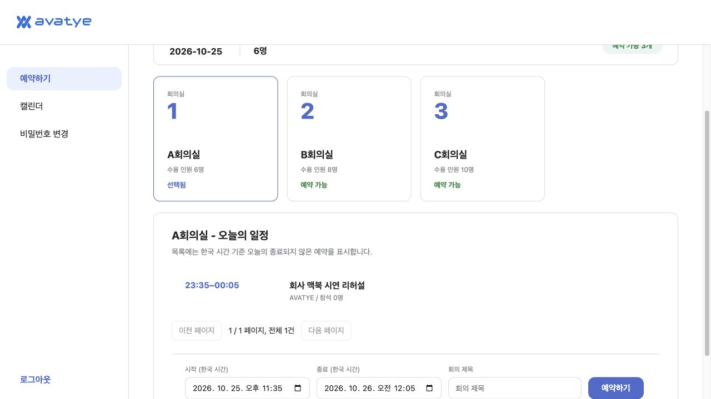
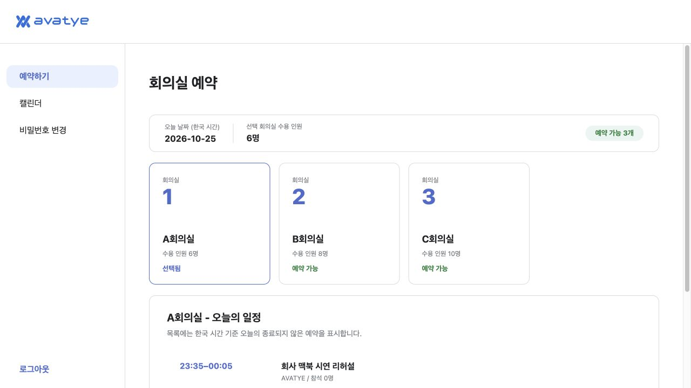

# 회사 맥북 시연 실행 검증

2026-10-25, SDK와 고객사 두 저장소를 나란히 둔 로컬 Mac의 Docker Desktop에서 검증했다. 회사 맥북 실기기에서는 아직 실행하지 않았다.

- 공식 Python 3.12, Node 24.21.0, PostgreSQL 17 이미지로 두 API와 두 웹 화면을 빌드했다.
- Docker 빌드 컨텍스트에서 기존 node_modules, dist, .venv, .env와 다른 프로젝트를 제외했다.
- `bash demo/start.command`가 두 DB의 마이그레이션과 QA 계정을 준비하고 다섯 서비스를 healthy로 실행했다.
- `bash demo/verify.command`로 실제 로그인, 인증 누락 및 위조 거부, 서버 간 확인, 예약 저장, 동일 예약 재전송, CTA 미참여를 확인했다.
- 브라우저에서 QA 계정으로 로그인하고 퍼즐을 직접 드래그한 뒤 CTA 없이 예약을 저장했다. 인증 직후 해당 예약은 0건, 계속하기 후 1건이었다. 콘솔 오류와 경고는 없었다.
- `stop.command`와 `start.command` 실행 후 같은 예약 ID가 유지됐으며 브라우저 새로고침 뒤 세션과 예약을 확인했다. 재시작 명령은 이미지를 추가로 내려받거나 빌드하지 않았다.
- 독립 리뷰에서 발견한 사용자 지정 포트 안내 오류는 실패하는 실행 테스트를 먼저 확인한 뒤 수정했다. `python demo/test_launcher.py` 1개 테스트가 통과했다.
- `demo/.env`는 권한 600으로 만들고 Git 및 Docker 빌드 컨텍스트에서 제외했다. 기존 업무 DB와 다른 서비스는 변경하지 않았다.

실행 방법은 [시연 시작 안내](../../../demo/README.md)를 따른다. 최초 실행에 필요한 이미지와 npm 및 Python 의존성은 회사 맥북에서 인터넷이 연결된 상태로 준비해야 한다.

